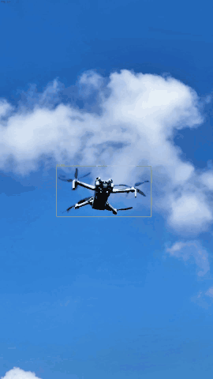
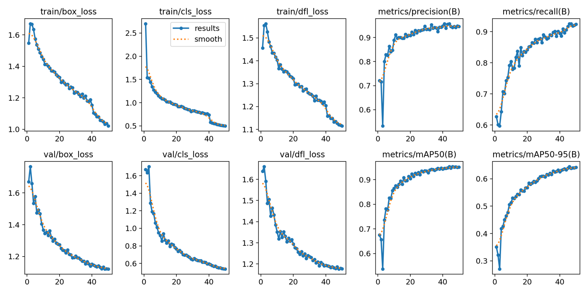
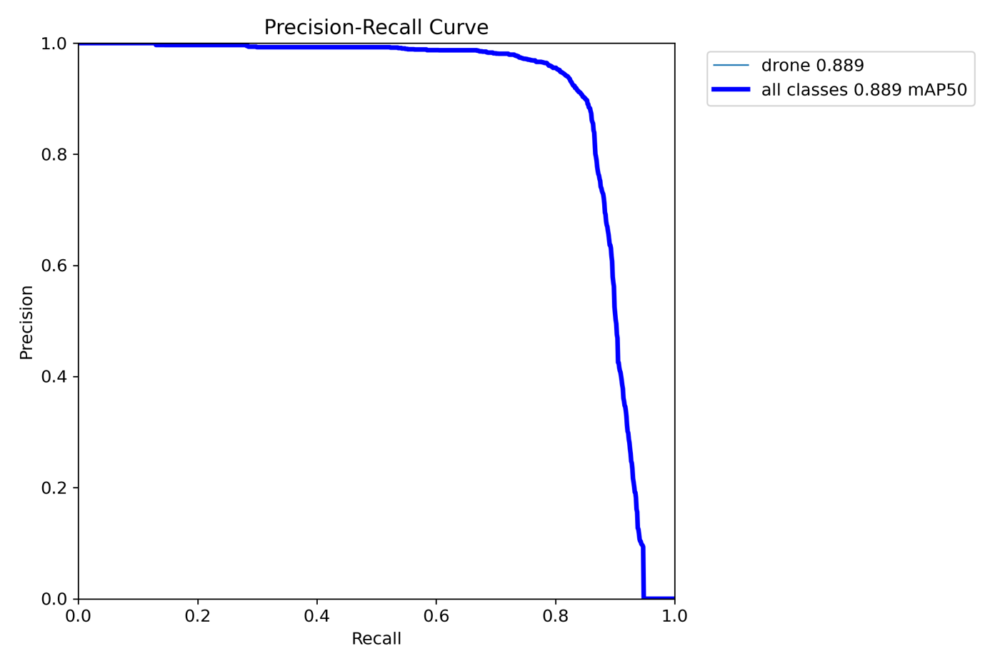
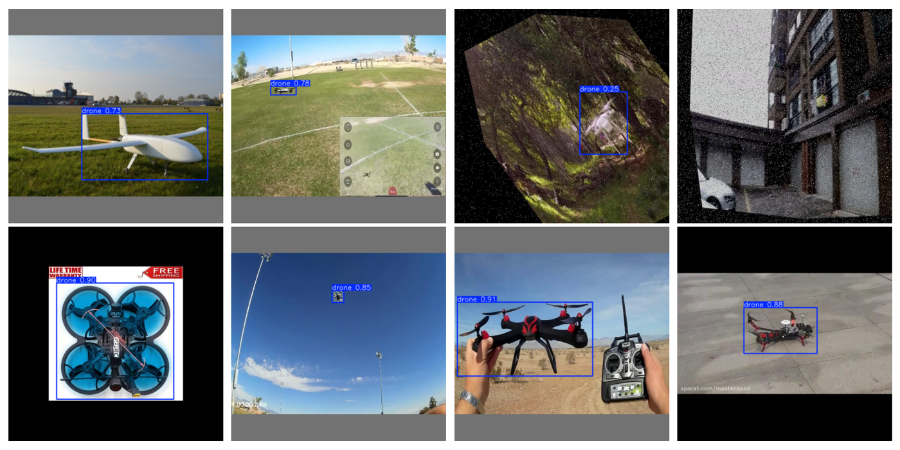

# Drone Tespit ve Takibi — YOLO11 + ByteTrack

YOLO11n ile drone tespiti, ByteTrack ile video üzerinde çoklu nesne takibi ve ONNX ile CPU üzerinde dağıtım. Değerlendirmede standart metriklere ek olarak nesne boyutuna göre recall analizi yapıldı.

> **EN:** Drone detection with YOLO11n fine-tuned on the Seraphim Drone Detection Dataset (mAP@0.5 0.889 on 2,000 held-out test images), ByteTrack-based tracking (43 FPS on a T4 with no ID switches on a 450-frame 4K clip), size-aware evaluation and ONNX export with CPU benchmarks.

<p align="center"></p>

## Sonuçlar

**Tespit** — test seti: 2000 görüntü, 2065 drone (eğitimde kullanılmayan ayrı bir veri parçası)

| Precision | Recall | mAP@0.5 | mAP@0.5:0.95 | Çıkarım (T4) |
|---|---|---|---|---|
| 0.927 | 0.828 | 0.889 | 0.576 | 3.8 ms/görüntü |

**Boyuta göre recall** (güven eşiği 0.25, IoU ≥ 0.5)

| Küçük (<32 px) | Orta (32–96 px) | Büyük (>96 px) |
|---|---|---|
| 0.915 (446 drone) | 0.856 (710) | 0.832 (909) |

**Takip** — 450 karelik 4K video, tek drone

| İz sayısı | Ortalama iz uzunluğu | FPS (T4, tespit + takip) |
|---|---|---|
| 1 | 450 kare (ID değişimi yok) | 43.2 |

**CPU hız ölçümü** (100 test görüntüsü, 640×640)

| Format | ms/görüntü | FPS |
|---|---|---|
| PyTorch | 117.6 | 8.5 |
| ONNX Runtime | 99.0 | 10.1 |

ONNX model boyutu: 10.7 MB.

## Bulgular

- **Model en çok büyük drone'larda zorlanıyor.** Recall küçük nesnelerde 0.92, büyük nesnelerde 0.83. Kameraya yakın drone'lar sık sık kadrajdan taşıyor, ayrıca pervane ve gövde detaylarıyla daha çeşitli görünüyor. Uzak drone'lar ise çoğunlukla düz gökyüzü önünde benzer koyu lekeler.
- **Doğrulama ve test arasında fark var.** Doğrulamada mAP@0.5 ≈ 0.95, testte 0.889. Doğrulama seti eğitimle aynı veri parçasından, test seti ise farklı bir parçadan geliyor. Bu fark, modelin yeni kaynaklardan gelen görüntülere genellemesindeki payı gösteriyor.
- **Eğitim 50 epoch'ta tam yakınsamadı.** mAP@0.5 0.95 civarında düzleşse de mAP@0.5:0.95 ve recall son epoch'larda hâlâ yükseliyordu. Daha uzun eğitim ve verinin tamamı (75 bin görüntü) ile ek iyileşme bekleniyor.
- **ONNX Runtime CPU'da ~%16 daha hızlı.** Gömülü cihazlar için INT8 kuantizasyon ve TensorRT bir sonraki adım.

| Eğitim eğrileri | PR eğrisi |
|---|---|
|  |  |



## Yöntem

- **Veri:** [Seraphim Drone Detection Dataset](https://huggingface.co/datasets/lgrzybowski/seraphim-drone-detection-dataset) (CC BY 4.0). Bir eğitim parçasından rastgele 8000 görüntü (%90 eğitim, %10 doğrulama) ve ayrı bir test parçasından 2000 görüntü.
- **Model:** COCO ön-eğitimli YOLO11n, 640 px, 50 epoch, mozaik veri artırımı (son 10 epoch kapalı).
- **Takip:** ByteTrack. Düşük güvenli tespitler ikinci aşamada mevcut izlerle eşleştirildiği için kısa süreli düşük skorlarda iz kopmuyor. Ayarlar küçük ve hızlı hedefler için uyarlandı: `track_low_thresh` 0.05, `track_buffer` 60 kare (`configs/bytetrack_drone.yaml`).
- **Boyuta göre değerlendirme:** Gerçek kutular COCO alan aralıklarına ayrıldı, her biri IoU ≥ 0.5 ile en fazla bir tahminle eşleştirildi.

## Çalıştırma

Colab: [`notebooks/drone_detection_colab.ipynb`](notebooks/drone_detection_colab.ipynb) (T4 GPU)

```bash
pip install -r requirements.txt
python src/prepare_data.py --train-batches 1 --test-batches 1 --max-train 8000
python src/train.py --data data/drone.yaml --epochs 50 --device 0
W=$(cat results/best_weights.txt)
python src/evaluate.py --weights $W --data data/drone.yaml
python src/track.py --weights $W --source drone_video.mp4
python src/export_benchmark.py --weights $W --images data/drone/test/images
```

```
src/
├── prepare_data.py      # veri indirme, train/val/test
├── train.py             # YOLO11 eğitimi
├── evaluate.py          # test metrikleri + boyuta göre recall
├── track.py             # ByteTrack ile video takibi
└── export_benchmark.py  # ONNX export + CPU hız ölçümü
configs/bytetrack_drone.yaml
notebooks/drone_detection_colab.ipynb
results/                 # metrik çıktıları (JSON)
```

## Sonraki adımlar
- Tüm veriyle ve daha uzun eğitim, YOLO11s ile karşılaştırma
- Küçük hedefler için SAHI ile parçalı çıkarım
- Kuş / uçak gibi benzer nesnelerle yanlış alarm analizi
- Jetson üzerinde TensorRT / INT8 ölçümü

## Kaynaklar
- Seraphim Drone Detection Dataset — CC BY 4.0
- [Ultralytics YOLO](https://docs.ultralytics.com) · [ByteTrack (Zhang vd., 2022)](https://github.com/ifzhang/ByteTrack)
